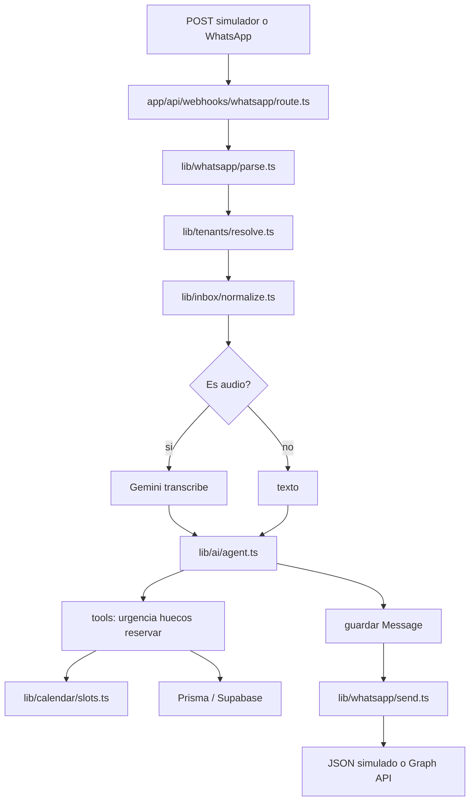

# Pety: plan de producto, código y aprendizaje

## Progreso rápido (actualizado 19 sep 2026)

| Etapa           | Estado        | Qué falta para cerrarla                                   |
| --------------- | ------------- | --------------------------------------------------------- |
| 0 Cimientos     | ◐ En progreso | Seed de clínica demo                                      |
| 1 HTTP echo     | ◐ En progreso | Alinear campos (`from`/`text`) y respuesta `{ ok, echo }` |
| 2 Persistir     | ○ Pendiente   | —                                                         |
| 3 Calendario    | ○ Pendiente   | `lib/calendar/slots.ts` está vacío                        |
| 4 Reglas sin IA | ○ Pendiente   | —                                                         |
| 5 Gemini        | ○ Pendiente   | `lib/ai/*` están vacíos                                   |
| 6 Reservar      | ○ Pendiente   | —                                                         |
| 7 Audio         | ○ Pendiente   | —                                                         |
| 8 WhatsApp      | ○ Pendiente   | `route.ts` existe pero vacío                              |
| 9 Listado       | ○ Pendiente   | —                                                         |

**Siguiente paso:** terminar Etapa 0 (seed) → cerrar Etapa 1 → Etapa 2.

Leyenda: ✓ hecho · ◐ en progreso · ○ pendiente

## Estado real (hoy, 19 sep 2026)

El repo [c:\Dev\pettyvetery](c:\Dev\pettyvetery) ya tiene **base de datos + simulador HTTP empezado**. Las carpetas del plan existen, pero varios archivos están **vacíos** (solo placeholders).

**Hecho:**

- Prisma 7 + schema en español + tablas en Supabase **PettyVetery** (`jijjqnujpnhhkohmvoav`)
- Cliente en [lib/db/prisma.ts](lib/db/prisma.ts)
- [app/api/simulate/inbound/route.ts](app/api/simulate/inbound/route.ts) con Zod (POST + validación)
- Estructura de carpetas: `lib/calendar`, `lib/ai`, `lib/whatsapp`, `lib/inbox`, `lib/tanants`

**Falta:**

- `prisma/seed.ts` (clínica demo)
- Lógica en archivos vacíos de `lib/`
- AI SDK v6 (todavía no instalado; `@google/generative-ai` no es el cerebro final)
- Kinde, Mercado Pago, dashboard y ARCA **no se tocan** hasta que el bot reserve turnos

Ritmo declarado: **3 a 5 horas por semana**. Eso es una sesión de 90–120 minutos, a veces dos. El bot en WhatsApp real, con una clínica de prueba, es un trabajo de **unas 14–16 semanas** si no salís del foco. Facturación, stock e historial clínico no entran en ese plazo.

## Decisión de producto (vos pediste recomendación)

Para veterinarias chicas de Argentina, el valor que pagan es **sacar el WhatsApp de la recepción**, no “un pedido que después confirman a mano”.

- Turno de rutina (vacuna, control, baño): el cliente elige un hueco **real** y queda **reservado al instante** (`status: scheduled`).
- Emergencia (convulsión, atropello, no respira, veneno, gato que no orina, sangrado que no para): **no se agenda**. El bot dice ir a guardia / llamar. La IA **no diagnostica ni indica dosis**.
- La clínica puede cancelar o mover el turno después (eso vive en un listado mínimo, no en un dashboard lindo).

Si cada mensaje sigue pidiendo un humano, no hay SaaS: hay un secretaria más cara.

Canal vendible: **WhatsApp Cloud API oficial de Meta**. Nada de Baileys/Evolution. En desarrollo el canal es un **simulador HTTP**; Meta entra cuando la tubería ya piensa.

## Contrato de mentoría (esto es tan importante como el código)

Vos sos el programador. Yo soy el líder técnico y el profesor. El objetivo de 2026 no es “que la IA te deje un repo”. Es que puedas leer una función, decir qué entra, qué sale, y corregirla sin pánico.

**Reglas de cada sesión (90–120 min):**

1. Un solo objetivo escrito en una frase (“recibir un POST y devolver JSON”).
2. Yo te doy: mapa mental, nombres de archivos, **firma** de la función, y el comando que prueba que funcionó (`curl` o un test).
3. Vos tipeás. Si te trabás: pegás el error + qué intentaste. Yo desbloqueo **ese paso**, no reescribo el proyecto.
4. Cierre: vos explicás en 4–5 frases qué archivo llama a cuál y qué dato viaja. Si no podés, el paso no está cerrado aunque “compile”.
5. Prohibido abrir una segunda feature en la misma sesión.

**Protocolo anti-congelamiento** (lo vas a repetir hasta que sea un reflejo):

1. ¿Cuál es el input? (JSON, texto, audio)
2. ¿Cuál es el output mínimo? (un `200` con `{ ok: true }` ya cuenta)
3. ¿Cuál es **una** transformación en el medio?
4. Codificá solo esa. El resto puede ser mentira temporal (`return []`).

Eso es exactamente lo que se evalúa en una entrevista: recortar el problema, tipar el contrato, probar el borde.

## Cómo se ve el éxito del MVP (lo único que importa ahora)

Tres pruebas, misma clínica demo, zona `America/Argentina/Buenos_Aires`:

- `“mi perro no para de convulsionar”` → urgencia alta/emergencia, **cero** turnos ofrecidos.
- `“quiero un turno para vacunar la semana que viene”` → 2 o 3 huecos reales según horarios y turnos ya tomados.
- Audio equivalente → misma tubería que el texto.
- Una segunda clínica seed **no ve** esos turnos.

Cuando eso funcione por simulador, recién conectamos WhatsApp. Cuando funcione por WhatsApp, recién hablamos de cobrar.



Regla de oro: **el Route Handler no piensa**. Recibe HTTP, llama a `lib/`, responde. La lógica vive en funciones con nombre claro. Eso es ingeniería; lo otro es un archivo de 400 líneas que te mareás.

## Stack: qué usamos y qué ignoramos

- **Next.js 16 App Router**: solo Route Handlers (`app/api/.../route.ts`). `page.tsx` se deja quieto.
- **TypeScript strict**: el compilador es el segundo mentor. Nada de `any`.
- **Supabase Postgres**: la base. Prisma 7 + `@prisma/adapter-pg` es cómo el servidor lee/escribe. El webhook **no** usa supabase-js.
- **Zod**: validar lo que entra. Nunca confiar en el body crudo.
- **AI SDK v6** (`ai` + `@ai-sdk/google`): `generateText` / `ToolLoopAgent` + tools. Gemini elige _qué_ tool; **vos** programás _cómo_ se buscan huecos.
- **date-fns** (o equivalente) + timezone fijo `America/Argentina/Buenos_Aires`. Los `Appointment.startsAt` se guardan en **UTC**.
- **Vercel**: deploy cuando el simulador ya pase las 3 pruebas.
- **WhatsApp Cloud API**: parse + send. Verificar firma cuando Meta esté en vivo.

Fuera de este bloque: Kinde, Mercado Pago, shadcn de pantallas, RLS fino de dashboard, colas, RAG, microservicios.

## Datos mínimos (multi-tenant desde el día 1)

Toda fila de negocio lleva `clinicId`. Sin eso no hay producto para 2 veterinarias.

- `Clinic`: nombre, timezone, `appointmentMinutes` (30), teléfono WhatsApp (después)
- `Veterinarian`: nombre, activo
- `VetWorkingHour`: `dayOfWeek` 0–6, `startTime`, `endTime` en hora local de la clínica
- `Client`: `phone` único por clínica
- `Conversation` + `Message`: historial; `wamid` único (idempotencia de Meta)
- `Appointment`: `startsAt`/`endsAt` UTC, `status`, constraint único `(veterinarianId, startsAt)` para no doble-bookear

Urgencia en el `Message` inbound: `none | low | high | emergency`.

## Cerebro de IA (sin magia)

No le pedimos a Gemini “hacé el SaaS”. Le damos herramientas, como a un empleado con agenda:

- `classify_and_reply`: entiende el mensaje; devuelve urgencia + texto (voseo rioplatense)
- `find_available_slots`: llama a **tu** `findAvailableSlots` en [lib/calendar/slots.ts](lib/calendar/slots.ts)
- `book_appointment`: transacción Prisma + unique constraint

Si la IA alucina un jueves 10:30 que no existe, tu función la contradice. Por eso el calendario se escribe **antes** que Gemini.

Algoritmo del calendario (lápiz primero, código después):

```
para los próximos N días:
  para cada vet activo:
    horario de ese día
    turnos ya tomados
    generar bloques de 30 min
    restar ocupados y horas ya pasadas
    devolver los primeros K huecos
```

Caso de prueba fijo: miércoles 10:00, vet 9–13, un turno a las 10:00 → **no** ofrecer 10:00. Esta función es oro en entrevistas.

---

# Bloque A — El chatbot (foco único)

Cada etapa = 1 o 2 sesiones. No saltes etapas. El simulador existe para que aprendas lógica **sin** pelearte con Meta.

### Etapa 0 — Cimientos (1–2 sesiones, ~2–3 h) ◐

Objetivo: Postgres alcanzable y una clínica demo.

- ✓ Cuentas: `DATABASE_URL` + `DIRECT_URL` en `.env` / `.env.local` (nunca al git).
- ✓ Prisma 7: [prisma.config.ts](prisma.config.ts), [prisma/schema.prisma](prisma/schema.prisma), adapter `pg`, cliente en [lib/db/prisma.ts](lib/db/prisma.ts).
- ✓ Tablas creadas en Supabase (`pnpm db:push`).
- ○ Seed: clínica “Pety Demo”, 2 veterinarios, lun–vie 9–13 y 16–20. **← próximo paso**
- ○ `GEMINI_API_KEY` en `.env.local` (lo pedimos en Etapa 5, no bloquea ahora).

Aprendés: variable de entorno, ORM vs base, por qué hay dos URLs.

Aceptación: `pnpm prisma db seed` y ves las filas. No hay HTTP todavía.

### Etapa 1 — HTTP que no piensa (1 sesión, ~90 min) ◐

Objetivo: un POST que no mienta sobre lo que recibió.

- ✓ Archivo: [app/api/simulate/inbound/route.ts](app/api/simulate/inbound/route.ts)
- ◐ Body Zod: hoy usa `{ clinicId, phone, message }` — alinear a `{ clinicId, from, text }` del plan
- ◐ Respuesta: hoy devuelve `{ success, data }` — alinear a `{ ok: true, echo }`
- ✓ Sin DB de mensajes (correcto por ahora)
- ✓ Zod instalado y `safeParse` funcionando

Aprendés: Route Handler, `Request`/`Response`, TypeScript como contrato.

Aceptación:

```bash
curl -X POST http://localhost:3000/api/simulate/inbound -H "Content-Type: application/json" -d "{\"clinicId\":\"...\",\"from\":\"54911...\",\"text\":\"hola\"}"
```

### Etapa 2 — Persistir (1–2 sesiones) ○

Objetivo: el mensaje queda guardado con dueño (clínica).

- ○ Carpeta [lib/tanants/resolve.ts](lib/tanants/resolve.ts) existe pero vacía (typo: `tanants` → renombrar a `tenants` cuando la toques)
- ○ Resolver o crear `Cliente` + `Conversacion` + `Mensaje` con `clinicaId`
- ○ El simulador deja de echo y responde `{ ok: true, messageId }`

Aprendés: relaciones, unicidad, por qué `clinicId` va en todo.

Aceptación: dos `curl` a clínicas distintas; los mensajes no se mezclan.

### Etapa 3 — Calendario puro (2–3 sesiones, la más importante para vos) ○

Objetivo: `findAvailableSlots` sin IA y sin WhatsApp.

- ○ [lib/calendar/slots.ts](lib/calendar/slots.ts) existe pero **vacío**
- ○ Función pura + datos de horarios/turnos inyectados (así se testea)
- ○ Script o test con reloj congelado

Aprendés: loops, fechas, UTC vs local, casos borde, tests. Acá se entrena el cerebro que hoy se mareá.

Aceptación: el caso del miércoles 10:00 ocupado falla el test si ofrecés 10:00.

### Etapa 4 — Ofrecer turnos con un if (1 sesión) ○

Objetivo: tubería completa **sin** Gemini.

- ○ Si el texto parece pedido de turno (regla barata, temporal), llamás `findAvailableSlots` y devolvéis huecos
- ○ Si no, respuesta fija

Aprendés: componer funciones. El `if` es una mentira útil; se borra en la etapa 5.

### Etapa 5 — Gemini con tools (2 sesiones) ○

Objetivo: el `if ("turno")` muere.

- ○ [lib/ai/provider.ts](lib/ai/provider.ts) — vacío
- ○ [lib/ai/prompts.ts](lib/ai/prompts.ts) — vacío
- ○ [lib/ai/agent.ts](lib/ai/agent.ts) — vacío
- ○ Instalar AI SDK v6 + `@ai-sdk/google`

Aprendés: API externa, tool calling, prompts como código, no como magia.

Aceptación: las dos frases de éxito (emergencia vs vacuna) salen bien por el simulador.

### Etapa 6 — Reservar de verdad (1–2 sesiones) ○

Objetivo: “¿te dejo el jueves 10:30 con Ana?” → sí → fila en `Cita`.

- ○ Tool `book_appointment` en transacción
- ✓ Unique constraint en schema: `(veterinarioId, iniciaEn)` ya definido en Prisma

Aprendés: transacciones, condiciones de carrera, idempotencia.

Aceptación: segundo `curl` al mismo hueco → error claro, no dos turnos.

### Etapa 7 — Audio (1 sesión) ○

Objetivo: el simulador acepta URL o archivo; Gemini transcribe; **misma** tubería que texto.

- ○ [lib/inbox/normalize.ts](lib/inbox/normalize.ts) — vacío

Aprendés: el canal no es la lógica. Audio es otro input hacia `normalize`.

### Etapa 8 — WhatsApp real + Vercel (2–3 sesiones) ○

Objetivo: el mismo `route.ts` habla con Meta.

- ○ [app/api/webhooks/whatsapp/route.ts](app/api/webhooks/whatsapp/route.ts) — existe pero **vacío**
- ○ [lib/whatsapp/parse.ts](lib/whatsapp/parse.ts) — vacío
- ○ [lib/whatsapp/send.ts](lib/whatsapp/send.ts) — vacío
- ○ GET verificación webhook + POST payload Meta + deploy Vercel
- ○ El simulador **se queda** para desarrollo local

Aprendés: webhooks, secrets, deploy, diferencia local vs producción.

Aceptación: mandás un audio y un texto desde tu celular al número de prueba; ves el turno en la DB.

### Etapa 9 — Listado crudo de turnos (1 sesión, wedge vendible) ○

- ○ Página server-side con tabla de turnos de la clínica demo (sin dashboard lindo)

Ahí termina el Bloque A. Recién ahí hay algo que mostrar a un humano del rubro.

---

# Bloque B — Primer peso (después del bot)

No se diseña en detalle hasta terminar la etapa 8. Orden:

1. **Una clínica real** (onboarding manual: vos cargás horarios en seed/SQL). Precio bajo, feedback brutal.
2. **Kinde Auth** + panel mínimo: ver turnos, cancelar, editar franjas. Acá sí shadcn.
3. **Multi-tenant de verdad**: `phoneNumberId` de Meta → `clinicId`. Cada clínica, su WhatsApp.
4. **Mercado Pago**: suscripción mensual. Sin esto no hay SaaS; hay hobby.

Meta de negocio honesta: no “vivir de esto” en el mes 4. Meta: **1 clínica usando el bot todas las semanas**. Después 5. El cobro sigue al uso, no al PowerPoint.

---

# Bloque C — El resto del SaaS (mapa, no trabajo)

Cuando el bot cobre, el orden de valor para una veterinaria argentina es este, no el de “app completa”:

1. Citas (ya existen en la DB; el panel las hace útiles)
2. Clientes + mascotas (hace falta para historial)
3. Historial clínico (notas por visita; no un HIS hospitalario)
4. Finanzas del día (turnos atendidos × precio simple; métricas chicas)
5. Export Excel de movimientos
6. Stock (después: es un producto entero)
7. Facturación ARCA/AFIP (último: legal, certificados, contingencia; no es un botón)

“Hablar con AI” interno del staff reusa el mismo agente con otro prompt. No es un segundo cerebro.

---

# Lo que no hacemos (ruido que te congela)

- Dashboard lindo antes del webhook
- Diagnóstico veterinario automático
- RAG / vector DB
- Colas (Inngest) hasta que Vercel timeout sea un problema real
- Dos sistemas de auth (Kinde **o** Supabase Auth; elegimos Kinde más adelante, Supabase = Postgres)
- WhatsApp no oficial
- Reescribir el schema entero “por si acaso”

## Próxima sesión recomendada

1. **Cerrar Etapa 0:** crear `prisma/seed.ts` → `pnpm prisma db seed` → ver filas en Supabase.
2. **Cerrar Etapa 1:** alinear campos del simulador al plan (`from`, `text`, `{ ok, echo }`).
3. **Empezar Etapa 2:** guardar el primer mensaje en `mensajes`.
