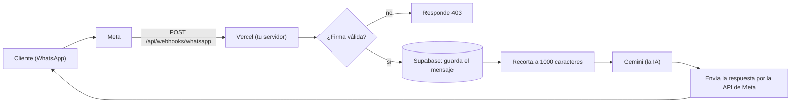
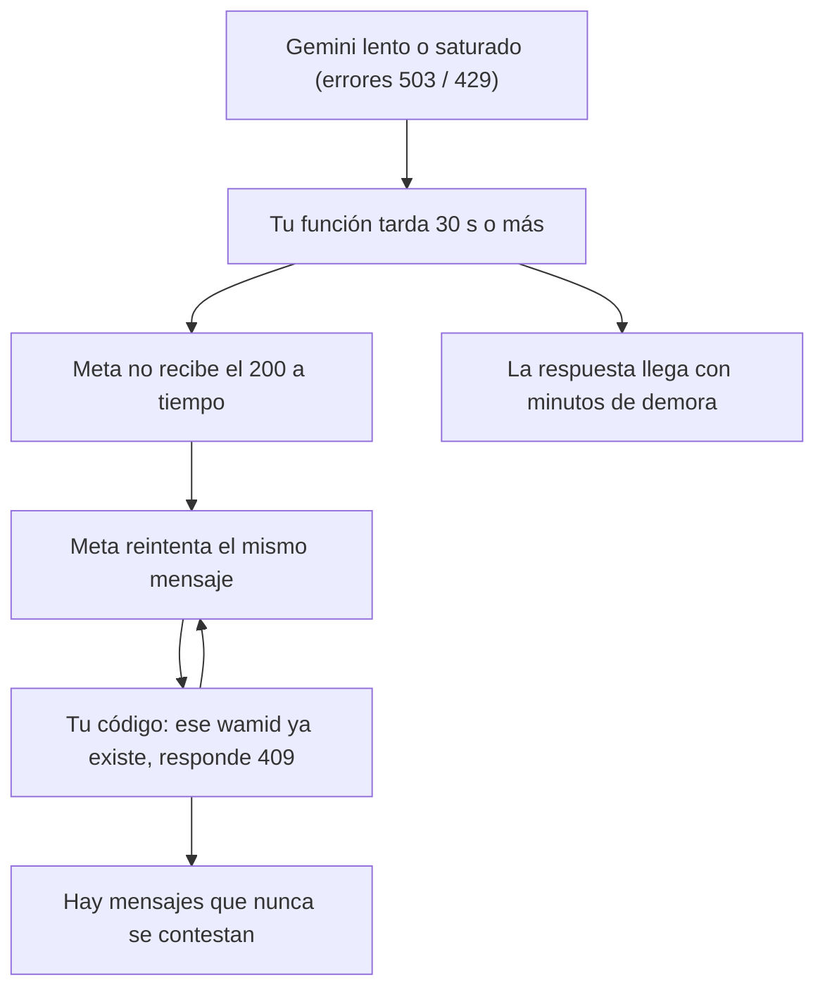

# 🗺️ Hoja de ruta PettyVet: de "funciona" a "listo para clientes"

> Última actualización: 2026-11-04.
> Esta hoja reemplaza el orden de las guías anteriores. Las equivalencias están en la sección 7.
> **Regla del curso:** el código lo escribe el alumno. La IA explica, da pistas y revisa.
> **Meta del alumno:** además de dejar PettyVet listo para vender, aprender ingeniería de software de verdad: arquitectura, patrones de diseño, una API REST robusta y segura (no un CRUD básico), rendimiento, leer código y traducirlo a lenguaje humano. Es también preparación para el mercado laboral junior argentino.

### 🤖 Instrucciones para cualquier IA que use este archivo (Claude, Cursor, etc.)

**Tu rol:** sos un maestro de ingeniería de software con mucha capacidad de enseñar. Tu alumno es un programador junior con poca lógica de programación. Escribe él todo el código.

1. **Nunca des código para copiar y pegar.** Da teoría, analogías, pistas, pseudocódigo, "qué entra / qué sale", palabras para buscar y links.
2. **Una tarea por vez**, siguiendo el orden de la sección 6. No mezcles numeraciones ni saltes pasos.
3. **Respuestas cortas, directas y graficas** (tablas, esquemas). Antes de dar la pista, hacé una pregunta de control.
4. **Revisá lo que escribe** y explicá el porqué de cada corrección.
5. **Antes de empezar, verificá el código real** contra esta hoja. Si hay diferencias, actualizá este archivo.
6. **Al cerrar una tarea,** marcala con ✅ (en el título y en el `- [x] Hecho`), anotá la fecha y actualizá la sección 3, la tabla de la sección 4 y la sección 6.
7. **Enseñá el porqué de ingeniería.** En cada tarea nombrá el concepto que está detrás (por ejemplo: idempotencia, backoff con jitter, rate limiting, separación de responsabilidades, fail closed) y dejá una palabra para investigar. El alumno quiere llegar a pensar como ingeniero, no solo a completar tareas.
8. **Sincronización entre IAs (Claude y Cursor):** este archivo es la única fuente de verdad. Al terminar una sesión, agregá una línea en la **sección 9 (Bitácora)** con fecha, qué IA, qué se hizo y qué sigue. Al empezar, leé la bitácora. Si el código real y la hoja no coinciden, mandan el código real y se corrige la hoja.
9. **Seguridad:** nunca pedir ni mostrar tokens, claves ni contraseñas en el chat.

**Leyenda de estados:** ✅ hecho · 🔄 en curso · ⬜ pendiente · ⚠️ hecho pero sin comprobar en producción

**📍 Estado actual (2026-11-04):**
- **✅ FASE E COMPLETA (2026-11-04), rama `fase-e-vercel` fusionada a `main`:** E1 (`after()` en el webhook), E2 (pool `max: 5`), E3 (variables de Vercel), E4 (logs), E5 (prueba de carga) y E6 (flujo de despliegue). Probada en producción con un mensaje real de WhatsApp. ⚠️ Los mensajes `FALLIDO` ya no se recuperan solos (opción A de E1; pendiente una opción C: reprocesarlos).
- **✅ FASE F COMPLETA (2026-11-03), fusionada a `main` (merge `e9013bc`):** F1 (rutas internas protegidas con `exigirApiKey`; `simulate/*` borradas), F2 (logs sin datos personales) y F3 (historial de Git sin secretos). Probado en producción con dos celulares. F3 confirmada: el alumno nunca mostró una clave fuera de su PC, no hay nada que rotar.
- **Fases completas: A, B, C, E y F.** D en curso (D2 ✅, D4 ✅; D1 pospuesta, D3 pendiente). Siguiente: a definir (bloque de producto, Fase I, o D1/D3).
- Fase A escrita y desplegada (rama `medir-tokens`, commit 448cadb). Prueba del 23/10 en producción: un mensaje respondido en pocos segundos, 0 tokens de razonamiento, sin reintentos. Falta ver el jitter y el corte por tiempo con fallas reales de Gemini.
- **✅ C1 hecho y verificado (2026-10-26):** usuario del sistema `pettyvet-bot`, token con caducidad "Nunca" cargado en Vercel (Production). El Access Token Debugger de Meta confirma Tipo System User, Caducidad Nunca y Válido.
- **B1 escrito (2026-10-25):** enum `EstadoMensaje` y campo `estado` aplicados en Supabase; el entrante nace `RECIBIDO`, pasa a `RESPONDIDO` tras enviar (probado en producción) y a `FALLIDO` en el `catch` (sin probar). **B2 escrito** (duplicado = 200, falta probar) y **B4 hecho (2026-10-26)**: `text` opcional en Zod y tipos, `case "text"` protegido, y audio u otros tipos reciben un aviso fijo y 200 (probado con un audio real). **✅ FASE B COMPLETA (2026-10-26): B1, B2, B3 y B4 hechas, probadas en producción (texto, audio y base de datos) y fusionadas a `main`.** **✅ FASE C COMPLETA (2026-10-26): C1, C2 y C3 hechas y fusionadas a `main` (merge 9a3f2ce).** **✅ D2 hecha (2026-10-28):** límite de 15 mensajes ENTRANTES por conversación en 24 horas, probado en WhatsApp y en la base; fusionada a `main` (merge 84be8fa). **Siguiente: F1** (proteger las rutas sin autenticación); D1 sigue pospuesta. Decisión del alumno: el enum `EstadoMensaje` tiene además el valor `GENERADO` (ya aplicado en la base, todavía sin usar en el código; falta definir cuándo se usa).
- **G4 hecho (2026-10-25):** el nombre del perfil de WhatsApp se guarda en `clientes.nombre` (probado en producción). Commit 28f8486.

---

## 0. Cómo usar esta hoja

1. Trabajá **una tarea por vez**, en orden. No saltes a la siguiente hasta cerrar la actual.
2. Cada tarea tiene siempre las mismas partes:

| Ícono | Parte | Para qué |
|---|---|---|
| 🎯 | Objetivo | Qué problema cierra, en una frase |
| 📁 | Dónde | Archivo y función exactos (tenés muchos `route.ts`, acá no hay dudas) |
| 🧠 | Concepto | Qué tenés que entender para hacerla |
| 🔎 | Investigá | Palabras para buscar en Google o en la documentación |
| ✅ | Listo cuando | Cómo sabés que terminaste |

3. Una tarea terminada = un commit. Nunca uses `git add .` en esta carpeta: agregá los archivos por nombre.
4. Antes de subir: `pnpm exec tsc --noEmit` (si no imprime nada, no hay errores de TypeScript).

---

## 1. El mapa (leelo antes de empezar)

### 1.1 El recorrido de un mensaje



### 1.2 El problema que viste en tus pruebas (hipótesis a confirmar con la tarea A1)



**Evidencia que tenés:** `Execution Duration 31.08s` en Vercel, decenas de `POST 409` seguidos durante más de 30 minutos, y un mensaje ENTRANTE de las 08:36 sin SALIENTE en la tabla `mensajes`.

### 1.3 Los `route.ts`: cuál es cuál

En Next.js **la ruta de carpetas es la URL**. Por eso hay muchos archivos con el mismo nombre.

| Archivo | URL | Quién lo llama | ¿Lo tocamos? |
|---|---|---|---|
| `app/api/webhooks/whatsapp/route.ts` | `/api/webhooks/whatsapp` | **Meta** | ✅ Casi todas las tareas |
| ~~`app/api/simulate/inbound/route.ts`~~ | `/api/simulate/inbound` | Vos (pruebas) | ✅ Borrada en la Fase F |
| ~~`app/api/simulate/conversation/route.ts`~~ | `/api/simulate/conversation` | Vos (pruebas) | ✅ Borrada en la Fase F |
| `app/api/clientes/route.ts` | `/api/clientes` | Administración | ✅ Protegida (F1) |
| `app/api/mensajes/route.ts` | `/api/mensajes` | Administración | ✅ Protegida (F1) |
| `app/api/conversacion/route.ts` | `/api/conversacion` | Administración | ✅ Protegida (F1) |
| `app/api/clinicas/route.ts` | `/api/clinicas` | Administración | ✅ Protegida (F1, GET y POST) |
| `app/api/clinicas/[id]/route.ts` | `/api/clinicas/:id` | Administración | ✅ Protegida (F1) |
| `app/api/health/db/route.ts` | `/api/health/db` | Chequeo de la base | No |

### 1.4 Los otros archivos importantes

| Archivo | Qué hace |
|---|---|
| `lib/whatsapp/firma.ts` | Verifica que el mensaje venga de Meta ✅ |
| `lib/ai/gemini.ts` | Llama a Gemini: reintentos, cambio de modelo, topes, razonamiento |
| `lib/ai/instrucciones.ts` | El prompt de PetyBot |
| `lib/whatsapp/send.ts` | Envía la respuesta por la API de Meta |
| `lib/whatsapp/formatear.ts` | Arregla el formato del teléfono argentino |
| `lib/db/prisma.ts` | Conexión a la base de datos |
| `prisma/schema.prisma` | Las tablas de tu base |
| `esquemas/whatsapp.ts` | Zod: valida el formato de lo que manda Meta |
| `interface/gemini.interface.ts` | El contrato de lo que devuelve la IA |

---

## 2. Niveles de prioridad

| Nivel | Significa | Fases |
|---|---|---|
| 🔴 **N1 Crítico** | Sin esto el bot falla o se pierden mensajes | A, B, C |
| 🟠 **N2 Importante** | Necesario antes de tener clientes reales (plata, estabilidad, seguridad) | D, E, F |
| 🟡 **N3 Necesario, no urgente** | Mejora calidad y orden del proyecto | G, H |
| ⚪ **N4 Producto** | Funciones nuevas (agenda, panel, fichas) | I |

---

## 3. Lo que ya está hecho ✅

- [x] Verificación de firma del webhook (`lib/whatsapp/firma.ts` y `app/api/webhooks/whatsapp/route.ts`)
- [x] El error 500 ya no devuelve el detalle interno (`route.ts`)
- [x] Medir tokens de Gemini (`lib/ai/gemini.ts`, `interface/gemini.interface.ts`)
- [x] Tope de entrada: `MAXIMO_CARACTERES = 1000` (`route.ts`)
- [x] Tope de salida: `MAXIMO_TOKENS_SALIDA = 2000` (`gemini.ts`)
- [x] Razonamiento limitado con `ThinkingLevel.LOW` (`gemini.ts`). Resultado: razonamiento de 490 a 0 tokens; costo por mensaje de ≈ US$ 0,0021 a ≈ US$ 0,00037
- [x] Cambios fusionados en `main`. Ojo: **fusionar no despliega**; el despliegue a producción se hace con `vercel --prod` desde tu carpeta local
- [x] A1: los reintentos a Gemini ya dejan rastro en los logs de Vercel (`lib/ai/gemini.ts`)
- [x] A2.1: timeout por llamada a Gemini (`TIMEOUT_LLAMADA_MS = 20000`)
- [x] A2.4: presupuesto total de tiempo de 15 s (`PRESUPUESTO_TIEMPO_MS`, función `calcularRestante`)
- [x] A2.2: 3 intentos por modelo en vez de 5 (`intentos = 3`)
- [x] A3: lista de modelos revisada (`3.5-flash-lite`, `3.6-flash`, `3.7-flash`, `3.8-flash`)
- [x] A2.3: jitter `Math.random() * 1000` sumado a la espera entre reintentos (commit 448cadb, 2026-10-23)
- [x] A2 desplegado y probado en la ruta normal (2026-10-23: respuesta en pocos segundos, sin reintentos)
- [ ] Pendiente de comprobar con fallas reales de Gemini: jitter, presupuesto de 15 s y timeout
- [x] C1 (parte de Meta): usuario del sistema `pettyvet-bot`, token con caducidad "Nunca" cargado en Vercel y redesplegado (2026-10-24)
- [x] C1 verificado (2026-10-26) en el Access Token Debugger: Tipo System User, Caducidad Nunca, Válido, ámbitos `whatsapp_business_management` y `whatsapp_business_messaging`
- [x] D2: `superoLimiteMensajes` (`lib/limites/clientes.ts`) con `LIMITE_MENSAJES = 15` en una ventana de 24 h; el entrante bloqueado queda `LIMITADO` y Meta recibe 200 sin llamar a Gemini (2026-10-28)
- [x] D4: aviso único al llegar al límite (`yaSeAvisoLimite`), fusionada a `main` y desplegada (2026-10-28)
- [x] F1: `lib/seguridad/apiKey.ts` (compara con `timingSafeEqual`) y `lib/seguridad/exigirApiKey.ts` (devuelve `Response` 401 o `null`) en la primera línea de cada handler interno; rutas `simulate/*` borradas. Probado: sin clave 401, clave mala 401, clave buena pasa (2026-11-03)
- [x] F2: `procesarMensajes.ts` ya no loguea el texto de la conversación (solo `id` y `wamid`) y los errores pasan por `detalleSeguro` (de los errores de Prisma solo se informa el código) (2026-11-03)
- [x] F3: historial completo de Git revisado: sin `.env`, sin claves de Gemini, Meta ni Supabase, sin `NEXT_PUBLIC_` con secretos (2026-11-03). El alumno confirmó que nunca mostró una clave fuera de su PC: nada que rotar
- [x] Fase F fusionada a `main` (merge `e9013bc`, 2026-11-03)
- [x] E1: el webhook responde 200 a Meta y procesa los mensajes dentro de `after()` (`app/api/webhooks/whatsapp/route.ts`, commit `8967652`). Probado en producción con un mensaje real (2026-11-04)
- [x] E2: `new PrismaPg({ connectionString, max: 5 })` en `lib/db/prisma.ts` (commit `e55c0fa`, merge `1b9590c`). Probado en producción (2026-11-04)
- [x] E3: las 7 variables de entorno están cargadas en Vercel (Production y Preview) (2026-11-04)
- [x] E4: sabe leer los logs de Vercel por palabra fija (`Tokens de entrada`, `mensajeSalida guardado`) (2026-11-04)
- [x] E5: prueba de carga contra `/api/health/db` en producción: 10, 50 y 100 conexiones, 7.623 pedidos, 0 errores (2026-11-04)
- [x] E6: se mantiene `vercel --prod` desde la PC, con checklist previo (decisión del alumno, 2026-11-04)

---

## 4. Resumen del roadmap

| Fase | Nivel | Estado | Qué resuelve | Tareas |
|---|---|---|---|---|
| **A** | 🔴 | ✅ **COMPLETA** (2026-10-23) | La IA es lenta y reintenta en silencio | A1 ✅, A2 ✅ (A2.1 ✅ A2.2 ✅ A2.3 ✅ A2.4 ✅), A3 ✅. Probada en la ruta normal; falta verla con fallas reales de Gemini |
| **B** | 🔴 | ✅ **COMPLETA** (2026-10-26) | Mensajes que se pierden o se reintentan sin fin | B1 ✅, B2 ✅, B4 ✅, B3 ✅. Desplegada y probada en producción (texto, audio y base de datos OK). Fusionada a `main`. Pendiente de pruebas automáticas (H3): FALLIDO, duplicado reenviado y evento con 2 mensajes |
| **C** | 🔴 | ✅ **COMPLETA** (2026-10-26) | La conexión con WhatsApp se puede caer | C1 ✅ (verificada), C2 ✅ (log quitado; regla del 9 a revisar con un número real), C3 ✅ (código de error de Meta; falta desplegar y ver un error real) |
| **D** | 🟠 | 🔄 | Proteger tu plata | D1 ⏸, D2 ✅ (2026-10-28), D3 ⬜, D4 ✅ escrito (2026-10-28, falta probar) |
| **E** | 🟠 | ✅ **COMPLETA** (2026-11-04) | Vercel y servidor bajo carga | E1 ✅, E2 ✅, E3 ✅, E4 ✅, E5 ✅ (solo `health/db`; falta un modo de prueba para el webhook), E6 ✅. Fusionada a `main` |
| **F** | 🟠 | ✅ **COMPLETA** (2026-11-03) | Seguridad del resto de la API | F1 ✅, F2 ✅, F3 ✅. Fusionada a `main` |
| **G** | 🟡 | ⬜ | Calidad del bot | G1 ⬜, G2 ⬜, G3 ⬜ |
| **H** | 🟡 | ⬜ | Orden y calidad del proyecto | H1 ⬜, H2 ⬜, H3 ⬜ |
| **I** | ⚪ | ⬜ | Producto | Ver la página principal en Notion |

**Fases completas: 5 de 9 (A, B, C, E y F).** Fase D en curso: D2 y D4 hechas; D1 pospuesta hasta antes de vender; D3 pendiente. Siguiente: a definir (el bloque de producto de la Fase I, o D1/D3). Además: firma del webhook, error 500 sin detalle, mediciones de costo y G4 (nombre del cliente).

---

## 5. Las fases en detalle

---

### 🔴 FASE A: La IA lenta y los reintentos silenciosos ✅ COMPLETA (2026-10-23)

#### A1 · Hacer visibles los reintentos ✅ (hecho el 2026-10-21)
- [x] Hecho
- 🎯 Saber por qué una respuesta tardó 31 segundos.
- 📁 `lib/ai/gemini.ts` → función `llamarConRetry` (aprox. líneas 126 y 127). Entre `if (!esTemporal || !menosIntentos) throw e;` y `await esperar(...)`.
- 🧠 Hoy, cuando Gemini responde 503 o 429, tu código espera (1, 2, 4, 8 s) y reintenta **sin escribir nada**. Solo avisa cuando se rinde. Por eso un mensaje lento no deja pistas.
- ✍️ Qué escribir: un `console.warn` de una línea con una palabra de búsqueda, el modelo, el número de intento (`i + 1`) y `e.status` (solo existe si `e instanceof ApiError`).
- 🔎 Investigá: "Gemini API error 429 vs 503", "Gemini API rate limits free tier".
- ✅ Listo cuando: un mensaje lento deja en los logs de Vercel líneas con tu palabra de búsqueda y ves qué error fue.
- 📊 **Resultado (2026-10-21), un solo mensaje que tardó 2 min 15 s:**
  - `gemini-3.8-flash`: 4 reintentos con error **503** y se rindió tras ~19 s (15 s de pura espera).
  - `gemini-3.7-flash`: 3 reintentos con **503**, uno con **429** (cuota excedida) y respondió recién en el 5.º intento.
  - **Una sola llamada tardó ~86 segundos** sin dar error: no hay límite de tiempo por llamada.
  - Meta reintentó el mismo mensaje a los ~25 s y a los ~2 min 14 s: cada vez recibió **409**.
  - Se hicieron 10 llamadas a Gemini para contestar un solo mensaje.
  - Conclusión: la hipótesis del diagrama 1.2 era correcta.

#### A2 · Poner un límite de tiempo ✅ escrita (A2.1 ✅, A2.2 ✅, A2.3 ✅, A2.4 ✅); falta comprobarla en producción ⚠️
- [x] Hecho (código). Pendiente: `vercel --prod` y revisar los logs
- ✅ **A2.1 hecho (2026-10-21)** ⚠️ sin comprobar en producción: `httpOptions.timeout = 20000` en `llamarConRetry`. Todavía no se vio en acción (no hubo llamadas colgadas desde entonces).
- ✅ **A2.4 hecho (2026-10-22):** presupuesto total `PRESUPUESTO_TIEMPO_MS = 15000`. `calcularRestante(inicio)` se consulta en 4 lugares: antes de cada modelo (`generateRespuestaIA`), antes de cada intento, en el timeout de la llamada (`Math.min`) y antes de esperar entre reintentos (`llamarConRetry`). Todavía falta desplegar y verlo en los logs.
- ✅ **A2.2 hecho (2026-10-22):** `intentos = 3` en la firma de `llamarConRetry`. Con 3 intentos cada modelo espera como máximo 3 s (1 s + 2 s); con 5 podía gastar los 15 s del presupuesto él solo.
- ✅ **A2.3 hecho (2026-10-23, commit 448cadb en `medir-tokens`)** ⚠️ sin comprobar en producción: `esperaRandom = Math.random() * 1000` se suma a la espera base (`tiempoEsperaFinal`), y esa misma espera se usa en la comprobación del presupuesto y en `esperar(...)`. Sobre el objetivo: jitter, un poco de azar en la espera entre reintentos para que varios mensajes que fallan a la vez no vuelvan todos juntos. Investigá `Math.random()`.
- 📋 **Orden con la evidencia de A1:** A2.1 timeout por llamada (la que más tiempo ahorra: habría cortado la llamada de 86 s) → A2.4 presupuesto total → A2.2 menos intentos y modelos → A2.3 jitter.
- 📋 **A2.1:** `config.httpOptions.timeout` (en milisegundos) en el mismo objeto `config` de `llamarConRetry`. Una llamada normal tarda 1 a 3 s; la colgada tardó 86 s.
- 📋 **A2.4:** Meta reintentó el mensaje por primera vez a los ~25 s. El presupuesto total tiene que ser **menor** que eso.
- 🎯 Que Gemini nunca pueda hacerte esperar minutos.
- 📁 `lib/ai/gemini.ts` → `llamarConRetry` y `generateRespuestaIA`.
- 🧠 **Presupuesto de tiempo:** fijás una fecha límite al empezar (`Date.now() + X`) y antes de cada reintento comprobás si ya te pasaste. Antes el peor caso eran 5 modelos × 5 intentos con esperas de hasta 15 s por modelo; ahora hay un presupuesto total de 15 s.
- 🔎 Investigá: "JavaScript AbortSignal.timeout", "exponential backoff with jitter", "graceful degradation".
- ✅ Listo cuando: con una API key inválida a propósito, el webhook responde en menos de 15 segundos.
- ❓ Pensá: si la IA no responde a tiempo, ¿qué le contestás al cliente?

#### A3 · Revisar la lista de modelos ✅ (hecho el 2026-10-22)
- [x] Hecho
- 📊 Lista final: `3.5-flash-lite`, `3.6-flash`, `3.7-flash`, `3.8-flash`. Tres figuran como estables en la documentación oficial (`3.5-flash-lite`, `3.6-flash` y `3.8-flash`). El `3.7-flash` no figura, pero respondió bien en producción: hay que vigilarlo en los logs.
- 🎯 No perder tiempo en modelos que no existen o dan error.
- 📁 `lib/ai/gemini.ts` → constante `MODELOS`.
- 🧠 En AI Studio → Uso viste errores `404 NotFound`: algún nombre de tu lista probablemente no existe. En la tabla de precios aparecen `gemini-3.8-flash`, `gemini-3.6-flash` y `gemini-3.5-flash-lite`.
- 🔎 Investigá: la página oficial de modelos de Gemini y la sección **Registros** de AI Studio.
- ✅ Listo cuando: cada nombre de la lista fue verificado y la lista es corta (2 o 3 modelos).

---

### 🔴 FASE B: Que ningún mensaje se pierda ✅ COMPLETA (2026-10-26)

> Esta fase es el cambio de diseño más grande. Tomala con calma.

#### B1 · Darle un estado a cada mensaje ✅ escrito (2026-10-25), ⚠️ falta probar FALLIDO
- [x] Hecho (código). `RESPONDIDO` probado en producción; `FALLIDO` sin probar (requiere provocar un fallo; se cubre con tests en H3).
- ✅ Código: `mensajeTexto` declarado fuera del `try`; `update` a `RESPONDIDO` tras guardar el saliente; `update` a `FALLIDO` en el `catch` con su propio `try/catch` (solo log, sin cambiar la respuesta 500). El P2002 no marca FALLIDO.
- ✅ Diseño y schema (enum `EstadoMensaje`, campo `estado?` en `Mensaje`), `db push` aplicado y entrante con `RECIBIDO` probado (2026-10-25).
- ⬜ Falta: `update` a `RESPONDIDO` tras el envío por WhatsApp y `FALLIDO` en el `catch`. Regla: `RESPONDIDO` solo cuando `sendMessageWhatsapp` terminó sin error. Los mensajes SALIENTES no llevan estado.
- 🎯 Poder distinguir "recibido", "respondido" y "fallido".
- 📁 `prisma/schema.prisma` → modelo `Mensaje`. Mirá cómo están hechos `DireccionMensaje` y `EstadoCita`.
- 🧠 **Idempotencia:** hacer algo dos veces tiene el mismo efecto que hacerlo una. Tu `wamid @unique` ya es una clave de idempotencia, pero hoy solo sirve para *rechazar* el duplicado.
- ⚠️ `pnpm db:push` toca tu base de producción. Probá primero en otra base o con una rama de Supabase.
- 🔎 Investigá: "idempotency key webhook", "Prisma enum".
- ✅ Listo cuando: el mensaje entrante guarda su estado y lo cambia al responder.

#### B2 · Un duplicado no es un error ✅ escrito (2026-10-26), ⚠️ falta probar
- [x] Hecho (código, rama `fase-b-mensajes`). Falta probarlo en producción reenviando un mismo webhook (hace falta una prueba con firma HMAC).
- ✅ Diseño: buscar por `wamid` antes de crear; `RESPONDIDO` y `RECIBIDO` reciente (< `UMBRAL_MENSAJE_COLGADO_MS` = 60 s) → 200 sin hacer nada; `FALLIDO` o `RECIBIDO` colgado → reprocesar reusando la fila (vuelve a `RECIBIDO`); el `P2002` queda como red de seguridad y devuelve 200.
- ⚠️ Limitaciones conocidas: (1) al reprocesar, `createdAt` no se reinicia, así que un segundo reenvío durante el reproceso de un mensaje colgado podría volver a procesarlo (se arreglaría con un campo `updatedAt`); (2) los mensajes anteriores a B1 (sin estado) se reprocesarían si Meta los reenviara: decidir si se tratan como ya procesados.
- 🎯 Que Meta deje de reintentar y que un fallo se pueda recuperar.
- 📁 `app/api/webhooks/whatsapp/route.ts` → el `catch` final (el `P2002` que hoy devuelve 409).
- 🧠 Si el mensaje ya estaba `RESPONDIDO` → devolvé **200** y no hagas nada. Si estaba `RECIBIDO` o `FALLIDO` → reintentá el trabajo.
- 🔎 Investigá: "Meta webhook retry behavior", "HTTP 200 vs 409".
- ✅ Listo cuando: reenviás el mismo webhook y el cliente recibe **una** respuesta.

#### B3 · Procesar todos los mensajes del evento ✅ escrito (2026-10-26), ⚠️ falta probar con 2 mensajes
- [x] Hecho (código, commit `e96c229`). Nueva función `lib/whatsapp/procesarMensajes.ts` (atiende UN mensaje, devuelve `true`/`false`); `route.ts` valida y busca la clínica una vez y hace `map` + `Promise.all` (paralelo, decisión del alumno). Responde 200 si todos `true`, 500 si alguno `false`. El nombre del cliente se busca con `find` por `wa_id` = `from`. No se pudo probar un evento con 2 mensajes a mano: queda para un script firmado o para los tests (H3). Limitaciones a vigilar: respuestas fuera de orden y error 429 de Gemini (5 por minuto en el nivel gratuito).
- 🎯 No perder mensajes cuando Meta agrupa varios.
- 📁 `route.ts` → hoy usa `entry[0].changes[0].value.messages[0]`.
- 🧠 Un `POST` puede traer varias entradas, cambios y mensajes. Hoy solo se procesa el primero.
- 🔎 Investigá: "JavaScript for...of", "Array.prototype.flatMap".
- ✅ Listo cuando: un evento con 2 mensajes genera 2 respuestas.

#### B4 · Mensajes que no son texto ✅ (hecho el 2026-10-26)
- [x] Hecho. Probado en producción con un audio real: el cliente recibe el aviso fijo y Meta recibe 200. Commit `e64ce6e` en `fase-b-mensajes`.
- ✅ Qué se hizo: `text` opcional (Zod y tipos); `if (!mensaje.text)` con `console.warn` y 200 en `case "text"`; `case "audio"` apilado con `default`; aviso con la constante `MENSAJE_TIPO_NO_SOPORTADO` enviado por `sendMessageWhatsapp`. El audio **no se guarda** en la base (decisión del alumno): un reenvío de Meta podría duplicar el aviso.
- 🎯 Que un audio o una foto no cause reintentos eternos.
- 📁 `esquemas/whatsapp.ts` (hoy `text` es obligatorio) y `route.ts` (`case "audio"` y `default`).
- 🧠 Hoy un audio falla la validación de Zod antes de llegar al `switch` y devolvés 400, así que Meta reintenta.
- ✅ Listo cuando: un audio recibe un aviso fijo ("por ahora solo entiendo texto") y el webhook responde 200.

---

### 🔴 FASE C: La conexión con WhatsApp

#### C1 · Token permanente ✅ (hecho el 2026-10-24, verificado el 2026-10-26)
- [x] Hecho en Meta y Vercel. Pendiente: verificar con el Access Token Debugger y un mensaje de prueba
- 📊 **Qué se hizo:** Business Settings → Usuarios del sistema → `pettyvet-bot` (Admin) → activos: app PettyVetery y las cuentas de WhatsApp "PettyVetery" y "Test WhatsApp Business Account" con acceso total → Generar token (caducidad Nunca, permisos `whatsapp_business_messaging` y `whatsapp_business_management`) → `WHATSAPP_ACCESS_TOKEN` en Vercel Production → redeploy.
- 🎯 Que el bot no se caiga cada 24 horas.
- 🚨 **Incidente real (2026-10-21, 22:17):** el token temporal venció, el mensaje de un cliente quedó guardado sin respuesta y nadie se enteró. El token nuevo generado desde "API Setup" también es temporal.
- 📁 Fuera del código: Meta Business Settings → Usuarios del sistema. Después, `WHATSAPP_ACCESS_TOKEN` en **Vercel → Production** + **Redeploy**.
- 🧠 El token de "API Setup" es temporal. El permanente se crea con un **usuario del sistema** con permisos `whatsapp_business_messaging`, `whatsapp_business_management` y `business_management`.
- 🔎 Investigá: "WhatsApp Cloud API permanent access token system user".
- ✅ Listo cuando: en el Access Token Debugger de Meta dice **Expires: Never** y **Type: System User**.

#### C2 · El número argentino ✅ (hecho el 2026-10-26, commit `d419286`)
- ✅ Se quitó el `console.log("pasaste por este bloque de codigo")`. **La regla del 9 NO se tocó** (decisión del alumno): hoy funciona con el número de prueba de Meta. Revisarla cuando se pruebe con un **número real** de producción (¿conviene enviar el formato completo con el 9?).
- [ ] Hecho
- 🎯 Que el envío no falle por el formato del teléfono.
- 📁 `lib/whatsapp/formatear.ts` (y sacar el `console.log("pasaste por este bloque de codigo")`).
- 🧠 Meta recomienda siempre número completo en formato internacional. La regla del `9` aplica sobre todo al número de prueba.
- ✅ Listo cuando: el log de debug no está y un número real recibe la respuesta.

#### C3 · Errores de Meta con su código ✅ (hecho el 2026-10-26, commit `91ba78d`)
- ✅ Qué se hizo: archivo nuevo `lib/whatsapp/errores.ts` con `CODIGO_META_TOKEN_VENCIDO = 190` y la clase `MetaApiError` (guarda `status`, `codigo`, `detalle`, `fbtraceId`). `send.ts` la lanza en vez de un `Error` genérico, registra una alerta fija ("ALERTA TOKEN DE META VENCIDO...") si el código es 190, y usa `.catch` en `respuesta.json()` para que una respuesta que no sea JSON no tape el error real.
- ⚠️ Falta ver un error real de Meta en producción (no se provoca a mano de forma segura); candidato para los tests de H3.
- [ ] Hecho
- 🎯 Distinguir "token vencido" (190) de "destinatario no permitido" (131030).
- 📁 `lib/whatsapp/send.ts` → el `throw new Error(...)` cuando `!respuesta.ok`.
- ✅ Listo cuando: el mensaje de error incluye status, código y detalle de Meta.

---

### 🟠 FASE D: Proteger la plata

#### D1 · Nivel pagado con tope de gasto ⏸ POSPUESTA (2026-10-26): hacerla antes de vender
- 📝 Investigado el 2026-10-26 (documentación oficial de Gemini): el pasaje a pagado pide **prepagar mínimo US$ 5**; con prepago la API **solo responde con saldo positivo** (el saldo es el techo, y si se acaba el bot se frena). AI Studio tiene un **tope mensual por proyecto** (página Spend, marcado como experimental, puede pasarse unos 10 minutos de demora). Las alertas de Google Cloud **avisan pero no frenan**. Los límites son **por proyecto, no por clave**: hay que subir el proyecto dueño de `GEMINI_API_KEY`. En el gratuito, Google puede usar los datos para mejorar sus productos: **no usar datos reales de clientes** hasta pasar a pagado.
- 🔄 **Orden corregido:** (1) decidir presupuesto máximo, (2) activar facturación en **prepago** con el mínimo, (3) poner el tope mensual en AI Studio, (4) crear una alerta en Google Cloud, (5) verificar. Ojo: sin saldo el bot deja de responder (se cubre con D4).
- 💰 Con ≈ US$ 0,00037 por mensaje, US$ 5 rinden unos 13.500 mensajes (los precios cambian: revisar).
- [ ] Hecho
- 🎯 Salir del nivel gratuito sin exponerte a una factura enorme.
- 📁 Fuera del código: Google AI Studio → **Gasto** y **Facturación**, y Google Cloud → Presupuestos y alertas.
- 🧠 Tu nivel gratuito permite **5 pedidos por minuto y 20 por día por modelo**, y usa tus datos para mejorar productos de Google. No sirve para clientes reales.
- ⚠️ **Orden:** primero preparás el tope de gasto, después activás la facturación.
- ✅ Listo cuando: hay un tope mensual y una alerta de presupuesto configurados.

#### D2 · Límite de mensajes por cliente ✅ (hecho el 2026-10-28)
- [x] Hecho y probado en WhatsApp y en la base (con el límite en 2). Valor final: `LIMITE_MENSAJES = 15` en `VENTANA_MS` = 24 h. Commits `0061fae` (feat) y `6cd22ad` (formato aparte); fusionada a `main` (merge `84be8fa`).
- ✅ Qué se hizo: `superoLimiteMensajes(conversacionId)` cuenta los ENTRANTES de la conversación en las últimas 24 h y devuelve `true` si `cantidad > LIMITE_MENSAJES` (el mensaje nuevo ya está guardado y se cuenta a sí mismo, por eso es `>`). En `procesarMensajes.ts`, después del `switch` y antes de Gemini: si supera, el entrante pasa a `LIMITADO` y se devuelve `true` (200 a Meta).
- ⚠️ Pendiente de diseño: los mensajes `LIMITADO` también son ENTRANTES y siguen contando en la ventana (quien insiste no se "destraba"); todavía no se avisa al cliente (eso es D4).
- 🎯 Que un número no pueda disparar cientos de llamadas a Gemini.
- 📁 Archivo nuevo `lib/limites/clientes.ts`, llamado desde `lib/whatsapp/procesarMensajes.ts` después de guardar el entrante y antes de llamar a Gemini.
- 🧠 **Ventana deslizante:** contás los mensajes ENTRANTES de esa conversación en la última hora. Tu índice `[conversacionId, createdAt]` ya hace rápida esa consulta.
- 🔎 Investigá: "Prisma count where gte", "rate limiting sliding window".
- ⚠️ Cuidado con el *error de uno*: el mensaje que acaba de llegar ya está guardado y se cuenta a sí mismo.
- ✅ Listo cuando: con el límite en 3, el cuarto mensaje no llama a Gemini y Meta recibe 200.

#### D3 · Cuota por clínica
- [ ] Hecho
- 📁 Misma carpeta `lib/limites/`.
- 🧠 Contás los SALIENTES de los últimos 30 días contra el tope de cada clínica.

#### D4 · Qué responder cuando se bloquea ✅ escrito (2026-10-28, rama `fase-d-aviso-limite`), ⚠️ falta probar
- [x] Hecho (código, delegado por el alumno a Claude). Aviso fijo `MENSAJE_LIMITE_ALCANZADO` una sola vez por ventana: `yaSeAvisoLimite` (en `lib/limites/clientes.ts`) cuenta los entrantes `LIMITADO` en 24 h y se pregunta ANTES de marcar el mensaje actual como `LIMITADO`. Un reenvío de Meta de un mensaje `LIMITADO` cuenta como ya atendido (no repite el aviso). Multi-clínica: el aviso sale por el `phoneNumberId` de la clínica del evento y va al `from` de ese mensaje; el límite es por conversación (única por clínica+cliente).
- 🧠 Siempre 200 a Meta. Un aviso fijo se manda **una sola vez** por ventana para no gastar en conversar con quien abusa.

---

### 🟠 FASE E: Vercel y el servidor ✅ COMPLETA (2026-11-04)

#### E1 · Responder rápido con `after()` ✅ (hecho el 2026-11-04)
- [x] Hecho. Commit `8967652`. La firma, la validación y la búsqueda de la clínica quedan antes del 200; `procesarMensajes` corre dentro de `after()`. La respuesta final es siempre 200 ("Evento recibido") y, si algún mensaje falla, solo se escribe un `console.error` fijo. Probado en producción con un mensaje real.
- ⚠️ Costo aceptado (opción A): con el 200 ya enviado, Meta no reintenta; un mensaje que falla queda `FALLIDO` y no se recupera solo. Pendiente futuro (opción C): un proceso que reprocese los `FALLIDO`.
- 🧠 Conceptos: *acknowledge fast, process async*, entrega al menos una vez, trade-offs de los reintentos.
- 🎯 Que Meta reciba el 200 enseguida y el trabajo pesado siga después.
- 📁 `route.ts`. Documentación de tu versión: `node_modules/next/dist/docs/01-app/03-api-reference/04-functions/after.md` y `.../02-route-segment-config/maxDuration.md`.
- 🧠 `after` se importa de `next/server`, corre después de enviar la respuesta y **usa el mismo tiempo máximo** de la ruta. Tu límite actual en Vercel es de 5 minutos.
- ⚠️ Si respondés 200 antes de procesar y el trabajo falla, **nadie reintenta**. Por eso depende de B1 y B2.

#### E2 · Conexiones a la base ✅ (hecho el 2026-11-04)
- [x] Hecho. `max: 5` por instancia (commit `e55c0fa`). El `DATABASE_URL` de Vercel es el mismo que el local y apunta al pooler de Supabase (puerto 6543). Región de las funciones: iad1 (Washington); la base está en Canadá (ca-central-1).
- 📁 `lib/db/prisma.ts` (hoy `new PrismaPg({ connectionString })` sin opciones).
- 🧠 Cada ejecución de Vercel abre su propio grupo de conexiones. Con mucha gente a la vez se agotan.
- 🔎 Investigá: "Supabase connection pooling Supavisor", "Prisma adapter-pg pool max".
- ✅ Listo cuando: sabés si tu `DATABASE_URL` usa el pooler y el pool de cada instancia es chico.

#### E3 · Variables de entorno en Vercel ✅ (hecho el 2026-11-04)
- [x] Hecho. Confirmadas en Vercel: `WHATSAPP_ACCESS_TOKEN`, `WHATSAPP_APP_SECRET`, `WHATSAPP_VERIFY_TOKEN`, `WHATSAPP_API_VERSION`, `WHATSAPP_PHONE_NUMBER_ID`, `GEMINI_API_KEY`, `DATABASE_URL`, `DIRECT_URL` y `API_KEY_INTERNAL`. Pendientes de revisar: marcar las claves como *Sensitive* ("Needs Attention") y separar los valores de Preview.
- 🧠 Las variables se configuran **por entorno** (Production, Preview, Development) y un cambio **no afecta a deploys ya hechos**: hay que redeployar.
- ✅ Checklist en Production: `WHATSAPP_ACCESS_TOKEN`, `WHATSAPP_APP_SECRET`, `WHATSAPP_VERIFY_TOKEN`, `WHATSAPP_API_VERSION`, `GEMINI_API_KEY`, `DATABASE_URL`.

#### E4 · Ver qué pasa en producción ✅ (hecho el 2026-11-04)
- [x] Hecho. Palabras fijas en los logs: `Tokens de entrada`, `Token Razonamiento`, `mensajeSalida guardado`.
- 🧠 Los logs de Vercel son tu única visibilidad. Buscá siempre por una palabra fija (`Tokens de entrada`, `Reintento:`). Revisalos después de cada cambio.

#### E5 · Prueba de carga ✅ (hecho el 2026-11-04)
- [x] Hecho (alcance reducido). Con `autocannon` contra `/api/health/db` en producción: 10, 50 y 100 conexiones simultáneas, 10 s cada una, 7.623 pedidos, **0 errores**, p50 ≈ 200 ms, p99 ≈ 513 ms (1671 ms en la primera por arranque en frío), hasta 488 pedidos/s. No se probó el webhook completo (gastaría Gemini y escribiría en la base real): queda como mejora un modo de prueba. El cuello de botella real es Gemini (5 pedidos/min en el nivel gratuito), no Vercel ni la base.
- 🧠 Nunca contra el Gemini real (gasta plata): hace falta un modo de prueba que devuelva un texto fijo con una espera artificial. Medí cuántos dan 200 y el percentil 95 de tiempo, con 10, 50, 100 y 300 pedidos.

#### E6 · Ordenar el flujo de despliegue ✅ (decidido el 2026-11-04)
- [x] Hecho. Decisión del alumno: Vercel **no** se conecta a GitHub; se despliega a mano con `vercel --prod`. Rutina: (1) rama correcta, (2) `git status` sin cambios sueltos, (3) `tsc --noEmit` sin errores, (4) commit y push, (5) `vercel --prod`, (6) mensaje de prueba por WhatsApp y mirar los logs. Para volver atrás: Deployments → Promote to Production.
- 🎯 Que lo que está en producción sea siempre algo que está guardado y probado.
- 🧠 Hoy desplegás con `vercel --prod` desde tu carpeta: **sube los archivos que tenés en disco en ese momento** (de la rama que tengas activa y también los cambios sin commitear). GitHub no despliega nada: solo guarda el historial.
- ✅ Checklist antes de cada `vercel --prod`: (1) `git status` sin cambios sueltos; (2) `./node_modules/.bin/tsc --noEmit` sin errores; (3) estás en la rama que querés publicar; (4) commit y push hechos.
- 🔎 Investigá: "Vercel Git integration production branch preview deployments", "vercel rollback".
- 💡 Más adelante: conectar Vercel con GitHub para que `main` despliegue solo y cada rama tenga una URL de prueba. Para poder desplegar desde `main` primero hay que arreglar H1 (accesos directos rotos de skills).

---

### 🟠 FASE F: Seguridad del resto de la app ✅ COMPLETA (2026-11-03)

#### F1 · Proteger o quitar rutas sin autenticación ✅ (hecho el 2026-11-03)
- [x] Hecho. Commits `aa970cc`, `cbbefee` y `723609e`; fusionada a `main`. Variable `API_KEY_INTERNAL` (en `.env` y en Vercel), header `x-api-key`, 401 si falta o es incorrecta, fail closed si la variable no existe. `health/db` queda pública a propósito y el webhook sigue con su firma.
- 🧠 Conceptos: autenticación vs. autorización, fail closed, comparación en tiempo constante, guard clause.
- ⚠️ La clave es una solución temporal: cuando existan cuentas de usuario (Fase I) se reemplaza por sesión y permisos por clínica. Pendiente menor: `clinicas/[id]` devuelve 400 (no 404) y `error: e` crudo.
- 📁 Todos los `route.ts` de la tabla 1.3 menos el webhook y `health`.
- 🧠 Hoy cualquiera con la URL puede leer y escribir clientes, mensajes y clínicas, y las rutas `simulate/` pueden crear mensajes falsos.
- ✅ Listo cuando: sin credenciales, esas rutas responden 401, o ya no existen en producción.

#### F2 · Logs con datos personales ✅ (hecho el 2026-11-03)
- [x] Hecho. Commit `225ee18`: la línea que imprimía `mensajeSalida` completo ahora imprime solo `id` y `wamid`, y los `console.error` de `procesarMensajes.ts` usan `detalleSeguro(e)`. Verificado en los logs de Vercel (2026-11-03): tras un mensaje real solo aparecen `id`, `wamid` y tokens, sin el texto de la conversación.
- 📁 `route.ts` (`console.log("mensajeSalida: ", ...)` imprime el texto de la conversación) y `app/api/clinicas/[id]/route.ts` (según tu página de Notion imprime el `Request` completo).

#### F3 · Claves ✅ (hecho el 2026-11-03)
- [x] Hecho. Búsqueda en todo el historial de Git (todas las ramas): sin `.env`, sin claves de Gemini, Meta ni Supabase. El alumno confirmó que nunca mostró una clave fuera de su PC, así que no hubo que rotar nada. Si en el futuro se expone una, rotarla (nuevo valor en `.env` y Vercel, y redeploy).
- 🧠 `.env` ya está ignorado por git ✅. Si alguna clave se mostró en un chat o captura, generá una nueva.

---

### 🟡 FASE G: Calidad del bot

- [ ] **G1 Memoria** · `route.ts` línea `conversacionPrevia: ""`. Traé los últimos N mensajes de la conversación y limitá su largo (si no, el costo crece).
- [ ] **G2 Prompt más seguro** · `lib/ai/instrucciones.ts`. Hoy el mensaje del cliente va dentro del mismo texto que las reglas, y puede pisarlas. Investigá `systemInstruction` en `@google/genai`.
- [x] **G4 Nombre del cliente** ✅ (2026-10-25) · `esquemas/whatsapp.ts`, `types/whatsapp.ts` y `route.ts`: se lee `value.contacts[0].profile.name` y se guarda al crear el cliente. Pendiente opcional: completar el nombre de clientes viejos con `update`.
- [ ] **G3 Conocimiento de la clínica** · hoy el bot responde "comunicate con la clínica" a todo porque no conoce horarios ni servicios. Depende de la agenda (Fase I).

---

### 🟡 FASE H: Orden del proyecto

- [ ] **H1 Accesos directos rotos en `.claude/skills/`**: son junctions que apuntan a `C:\Dev\pettyvetery\.agents\skills\...`, una ruta que ya no existe. Hasta arreglarlos, `git pull` o `git switch main` en esta carpeta pueden fallar.
- [ ] **H2 Proyecto viejo del grafo de código** (`C-Dev-pettyvetery`): borrarlo.
- [ ] **H3 Tests del webhook** (firma, duplicados, errores de IA y de envío), README real y migraciones versionadas (`prisma migrate`) en vez de `db push`.

---

### ⚪ FASE I: Producto

Agenda y citas, autenticación y multi-clínica, panel de administración, fichas clínicas, recordatorios, planes y precios. El detalle está en la página principal del proyecto en Notion (módulos 5 y 6).

**🔄 En curso (2026-11-06), rama `fase-i-producto`.** Decisiones: lanzar con 2 planes (Consultorio $39.999 y Clínica $79.999; Sedes queda "próximamente"); prueba de 7 días **con tarjeta** (Mercado Pago); registro por **Server Action** + Supabase Auth.
- [x] **Datos:** `Clinica` con `ownerId`, `plan` (`PlanClinica`), `estadoSuscripcion` (`EstadoSuscripcion`), `pruebaTerminaEn` y `mpSuscripcionId`; aplicado a Supabase (commit `09cf4e4`).
- [x] **I1 (parte 1):** clientes de Supabase (`lib/supabase/client.ts` y `server.ts`), `actions/registro.ts` y página `/registro` (commits `193c7fd` y `9d679f1`). Probada la validación en el navegador; falta probar un registro real.
- [ ] **I1 (parte 2):** ruta `/auth/confirm` que reciba el link del email (plantilla "Confirm signup" con `token_hash`), página de login y `proxy` que renueva la sesión y protege páginas.
- [ ] I2 formulario de alta de la clínica · I3 suscripción con prueba (Mercado Pago) · I4 acceso según plan · I5 panel · I6 número de WhatsApp por clínica.
- ⚠️ **DEUDA DE SEGURIDAD (2026-11-06):** en Supabase (proyecto `main`, PRODUCTION) se apagó **"Confirm email"** solo para avanzar con el desarrollo. **Antes de lanzar hay que volver a prenderlo** y terminar la ruta `/auth/confirm`; si no, cualquiera puede registrarse con un email ajeno.
- ⚠️ Antes de desplegar `/registro`: cargar `NEXT_PUBLIC_SUPABASE_URL` y `NEXT_PUBLIC_SUPABASE_PUBLISHABLE_KEY` en Vercel.

---

## 6. Orden de trabajo recomendado

```
1.  A1  Hacer visibles los reintentos        ✅ hecho
2.  A3  Revisar la lista de modelos          ✅ hecho
3.  A2  Límite de tiempo (A2.1 a A2.4)       ✅ hecho y probado en la ruta normal
4.  C1  Token permanente                     ✅ hecho y verificado (Expires: Never)
5.  B1  Estado de cada mensaje               ✅ hecho (FALLIDO sin probar)
6.  B2  Duplicado = 200                      ✅ escrito (falta probar)
7.  B4  Mensajes que no son texto            ✅ hecho y probado
8.  B3  Varios mensajes por evento           ✅ escrito (falta probar con 2 mensajes)
    ── ✅ FASE B COMPLETA: desplegada, probada en producción y fusionada a main ──
9.  C2 y C3  Formato de número y errores de Meta   ✅ hechas
    ── ✅ FASE C COMPLETA (2026-10-26), fusionada a main (merge 9a3f2ce) ──
11. D1  Nivel pagado con tope de gasto             ⏸ POSPUESTA (hacerla ANTES de vender; no hay presupuesto ahora)
12. D2  Límite por cliente                         ✅ hecho y probado (2026-10-28)
13. F1, F2 y F3  Seguridad de la API              ✅ hechas (2026-11-03)
    ── ✅ FASE F COMPLETA (2026-11-03), fusionada a main (merge e9013bc) ──
14. E1 a E6  Vercel y carga                        ✅ hechas (2026-11-04)
    ── ✅ FASE E COMPLETA (2026-11-04) ──  ← SIGUIENTE: a definir (Fase I, o D1/D3)
15. D3 y D4  Cuota por clínica y avisos
16. G, H, I
```

---

## 6.1 Por qué este orden (de lo crítico a lo secundario)

| Bloque | Tareas | Qué evita |
|---|---|---|
| 🔴 **Que no se pierdan mensajes** | B1, B2, B4, B3 | Clientes sin respuesta y reintentos infinitos de Meta |
| 🟠 **Que no te lleve a la ruina** | D1, D2 | Facturas inesperadas y abuso de un solo número |
| 🟠 **Que no te hackeen** | F1, F2 | Rutas abiertas y datos personales en los logs |
| 🟠 **Que aguante carga** | C2, C3, E1, E2, E3, E5 | Caídas con muchos clientes a la vez |
| 🟡 **Calidad y orden** | D3, D4, G, H | Un bot más útil y un proyecto mantenible |
| ⚪ **Producto** | I | Funciones para vender (agenda, panel, planes) |

## 6.2 Mapa de aprendizaje (conceptos de ingeniería que vas a practicar)

| Tarea | Concepto de ingeniería | Para investigar |
|---|---|---|
| A2 | Backoff exponencial con jitter, presupuesto de tiempo | "exponential backoff and jitter" |
| B1, B2 | Idempotencia, máquina de estados | "idempotency key", "state machine" |
| B3, B4 | Procesar lotes, validación de entradas | "Zod discriminated union" |
| C1 | Credenciales de servicio vs. de persona | "service account vs user token" |
| D1, D2 | Rate limiting, control de costos | "sliding window rate limiting" |
| F1 | Autenticación y autorización | "REST API authentication", "OWASP API Security Top 10" |
| E1 | Procesamiento asíncrono, colas | "background jobs", "message queue" |
| E2 | Pool de conexiones | "connection pooling" |
| G1, G2 | Contexto y seguridad del prompt | "prompt injection" |
| H3 | Pruebas automáticas | "unit test vs integration test" |
| General | Arquitectura en capas y separación de responsabilidades | "layered architecture", "clean architecture", "REST API design best practices" |

---

## 7. Equivalencias con la guía anterior (`guia-costos-y-rendimiento.md`)

| Guía vieja | Ahora |
|---|---|
| Fase 1 (medir tokens) | ✅ Hecho |
| Fase 2 (topes) | ✅ Hecho |
| Fase 3 (límite por cliente) | D2 |
| Fase 4 (cuota por clínica) | D3 |
| Fase 5 (idempotencia) | Fase B |
| Fase 6 (presupuesto de tiempo) | Fase A |
| Fase 7 (`after`) | E1 |
| Fase 8 (conexiones) | E2 |
| Fase 9 (prueba de carga) | E5 |

---

## 9. Bitácora entre IAs (Claude y Cursor)

> Una línea por sesión: fecha · IA · qué se hizo · qué sigue. Lo más reciente arriba.

| Fecha | IA | Qué se hizo | Qué sigue |
|---|---|---|---|
| 2026-11-04 | Claude | **FASE E COMPLETA.** E1 (`after()`, commit `8967652`), E2 (`max: 5`, commit `e55c0fa`), E3, E4, E5 (7.623 pedidos a `health/db`, 0 errores) y E6 (se mantiene `vercel --prod`). Probado en producción con un mensaje real. Rama `fase-e-vercel` fusionada a `main` | Decidir: Fase I (cuentas, planes, Mercado Pago), D1 (Gemini pagado) o D3. Pendiente futuro: reprocesar los `FALLIDO` y un modo de prueba para el webhook |
| 2026-11-03 | Claude | **FASE F COMPLETA y fusionada a `main`** (merge `e9013bc`). F1: `exigirApiKey` en las 6 rutas internas, `simulate/*` borradas, probado en producción con dos celulares. F2: logs sin texto de conversaciones. F3: historial de Git sin secretos. Se dejó la visión de producto (cuentas, planes, Mercado Pago, panel) para la Fase I | Decidir entre E y la Fase I; definir cuántos planes y si la prueba pide tarjeta |
| 2026-10-28 | Claude | **D4 subida y fusionada a `main`** (commit `bf5ef90`, merge de `fase-d-aviso-limite`). Límite final en 15 | Desplegar con el checklist E6 (`vercel --prod`); después F1 en rama nueva |
| 2026-10-28 | Claude | **D4 escrito** (aviso único al llegar al límite) en la rama `fase-d-aviso-limite`, commit local sin push. Delegado por el alumno | Probar con el límite en 2 (3 mensajes: aviso una vez; 4.º en silencio), volver a 15, push y fusionar; después F1 |
| 2026-10-28 | Claude | **D2 hecha y probada** (WhatsApp y base): `superoLimiteMensajes` con límite 15 en 24 h; el entrante bloqueado queda `LIMITADO`. Commits `0061fae` y `6cd22ad` (formato aparte), **fusionada a `main`** (merge `84be8fa`). La Fase C ya estaba en `main` (se corrigió la hoja). Pendiente de diseño: `LIMITADO` cuenta en la ventana | F1 (proteger rutas); crear rama nueva (ej. `fase-f-seguridad`) |
| 2026-10-26 | Claude | **FASE C COMPLETA.** C1 verificada (Access Token Debugger: System User, Nunca), C2 (commit d419286, log quitado), C3 (commit 91ba78d, `MetaApiError` con código de Meta). Todo en `fase-c-whatsapp`, pendiente de fusionar a `main` | Fase D: D1 (nivel pagado con tope de gasto), D2 (límite por cliente) |
| 2026-10-26 | Claude | **FASE B COMPLETA.** Desplegada y probada en producción por el alumno: un texto respondió bien y la base quedó correcta; un audio recibió el aviso fijo. Hoja y Notion actualizados | Fase C en `fase-c-whatsapp`: C2 y C3 |
| 2026-10-26 | Claude | B3 hecho (e96c229). **Fase B fusionada a `main`** (merge f3ae763). Nueva rama de trabajo: **`fase-c-whatsapp`** | C2 (formato del número) y C3 (errores de Meta con su código); antes, probar B en producción |
| 2026-10-26 | Claude | B2 (duplicados, commit 3e01523) y B4 (mensajes no texto, commit e64ce6e) hechos en `fase-b-mensajes`; B4 probado con audio real; enum con `GENERADO` agregado por el alumno (f2985f6) | B3: varios mensajes por evento |
| 2026-10-25 | Claude | Fusión de `medir-tokens` a `main` (merge 7ce08b8, hasta B1). Nueva rama de trabajo: **`fase-b-mensajes`** (B2, B4, B3; un commit por tarea). Al terminar la Fase B: fusionar a `main` y abrir rama nueva para la Fase C | B2 |
| 2026-10-25 | Claude | B1 cerrado en código: `RESPONDIDO` y `FALLIDO` (commit en `medir-tokens`) | B2: duplicado = 200 |
| 2026-10-25 | Claude | G4 nombre del cliente (commit 28f8486); B1: schema + `RECIBIDO` aplicados y probados | B1: `RESPONDIDO` y `FALLIDO` en `route.ts` |
| 2026-10-24 | Claude | C1 hecho en Meta/Vercel; hoja reorganizada (secciones 6.1, 6.2 y 9) | Verificar C1 y empezar B1 |
| 2026-10-23 | Claude | A2.3 jitter, commit 448cadb en `medir-tokens`; prueba en producción OK | C1 |
| 2026-10-22 | Claude | A2.1, A2.2, A2.4 y A3 | A2.3 |

---

## 8. Glosario

| Palabra | Significado |
|---|---|
| **Token** | Pedazo de texto que Google cobra |
| **Razonamiento** | Tokens que Gemini "piensa" antes de responder; se cobran como salida |
| **Log** | El diario que escribe tu servidor |
| **Webhook** | Una URL tuya a la que Meta avisa cuando llega un mensaje |
| **wamid** | El identificador único de cada mensaje de WhatsApp |
| **Reintento** | Volver a intentar algo que falló |
| **Idempotente** | Repetirlo no cambia el resultado |
| **409 / 429 / 503** | Conflicto / demasiados pedidos / servicio no disponible |
| **Pool** | Grupo reutilizable de conexiones a la base |
| **p95** | El valor que el 95% de los casos no supera |
| **Junction** | Acceso directo de carpeta de Windows |
